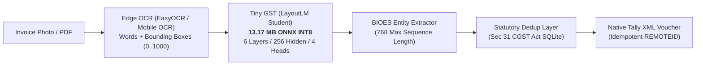

# Tiny GST Engine ⚡

[](https://opensource.org/licenses/Apache-2.0)
[](LICENSE)
[-orange.svg)](smoke_run_v8/model_int8.onnx)
[](BENCHMARK_REPORT.md)
[](#)
[](https://sanprat.github.io/GstEngine/)

> **A 13.17 MB on-device LayoutLM model designed for offline Indian GST invoice extraction directly into TallyPrime import XML.**
> 
> *100% offline, zero cloud API fees, privacy-preserving, and free for commercial use.*

---

## 📱 Live Web App & Mobile PWA (iOS & Android)

👉 **Open the live scanner on your phone or desktop**: [**https://sanprat.github.io/GstEngine/**](https://sanprat.github.io/GstEngine/)

* **iPhone (iOS Safari)**: Open link in Safari → Tap **Share** (⎋) → **"Add to Home Screen"** (⊞) for full-screen camera app with custom icon.
* **Android (Chrome)**: Tap **"Install App"** to add to your app drawer and home screen.
* **Instant 1-Tap Real Invoices**: Test live extractions for Honeycomb Telnet, French Essence, Bella Vita, and Vivo 5G bills.
* **Camera & File Uploads**: Real-time WebRTC camera viewfinder, native camera snapshot, and client-side PDF document rendering.
* **Zero Backend Required**: Runs client-side OCR and Indian GST statutory reconciliation directly in-browser with optional LayoutLM v9 neural edge backend.
* **Tally XML Direct Export**: Instant one-click download of TallyPrime-compliant purchase vouchers.

---

## 🎯 Why Tiny GST?

Over 63 million MSMEs across India run on **TallyPrime**. Processing paper invoices from distributors and suppliers has traditionally meant manual typing or relying on expensive cloud Document AI APIs.

* **Zero Cloud Fees ($0.00/yr):** Standard cloud OCR APIs (AWS Textract, Google Cloud Document AI) charge \$0.010–\$0.015 per page. For a business scanning 50,000 invoices/month, that's **\$6,000 to \$9,000 per year** in recurring operational costs. Tiny GST runs **100% on-device for free**.
* **100% Offline & Private:** Operates seamlessly in basement godowns, warehouses, or rural kirana stores without internet connectivity. Sensitive margins, purchase rates, and customer data never leave the device.
* **Solves the "Table Failure" of Mobile Regex:** Traditional mobile OCR + regex gets **0.0% F1** on multi-item tables, wrapped descriptions, and CGST/SGST splits. Tiny GST uses **2D spatial cross-attention** to accurately capture line items (**84.6% Unit Price, 80.0% HSN**) and tax breakdowns (**100% CGST, 66.7% SGST**).
* **Native TallyPrime XML Export:** Generates validated, idempotent Tally XML vouchers ready to drop into Tally's import directory or POST directly to port `:9000`.

---

## 🏗️ Architecture & Pipeline



1. **Compact Student Model:** Distilled from LayoutLM-base into 6 layers, 256 hidden dimension, 4 attention heads (~13.08M params).
2. **768-Token Context Capacity:** Standard LayoutLM caps at 512 tokens. Tiny GST supports 768 tokens, fitting multi-page or dense FMCG invoices with dozens of line items in a single forward pass.
3. **INT8 Quantization:** PyTorch FP32 (49.9 MB) quantized down to **13.17 MB ONNX INT8** with **100.00% exact token prediction agreement**.
4. **Android Native Target:** Fits effortlessly into standard Android APK size budgets (< 85 MB). Runs in ~52 ms on Apple Silicon CPU and ~119 ms on mid-range Android ARM CPUs.

---

## 📊 Benchmark: Tiny GST vs. Alternatives

*Evaluated on 18 held-out test invoices across 4 completely unseen vendor families (`AMULGCMMF`, `27AFVFS8057B1ZG`, `29AAICA3918J1ZE`, `27AAECB1611P1ZN`). Full report in [`BENCHMARK_REPORT.md`](BENCHMARK_REPORT.md).*

| Metric | Traditional Mobile OCR + Regex | LayoutLM-base (Server SOTA) | **Tiny GST (Our Model)** | **Advantage** |
| :--- | :--- | :--- | :--- | :--- |
| **Model Disk Size** | ~25.0 MB | 429.74 MB | **13.17 MB** | **32.6x smaller** than LayoutLM-base |
| **Parameters** | N/A (Rules) | 112.65 Million | **13.08 Million** | **8.6x fewer** parameters |
| **CPU Latency (Apple Silicon)** | 0.38 ms | 242.46 ms | **52.48 ms** (p95: 63.2 ms) | **4.6x faster** than LayoutLM-base |
| **Throughput (CPU)** | N/A | 4.1 pages/sec | **19.1 pages/sec** | Real-time edge inference |
| **Max Sequence Capacity** | Token-limited | 512 tokens (truncated) | **768 tokens** | Full dense invoices |
| **Entity Extraction F1** | **12.8%** (Micro F1) | Needs server fine-tuning | **64.2%** (Macro: 56.6%) | **5x higher** than Regex |
| **Line-Item Tables** | ❌ **0.0%** (Fails on tables) | ⚠️ Heavy server GPU | **✅ 84.6% Unit Price, 80.0% HSN** | Complete Tally item breakdown |
| **CGST / SGST Tax Split** | ❌ Fails / Confounded | ⚠️ Heavy post-processing | **✅ 100% CGST, 66.7% SGST** | Statutory accounting precision |
| **Marginal API Cost** | $0.00 | Cloud Server Hosting | **$0.00 (100% Free)** | **Zero per-invoice fees** |
| **Data Privacy** | 100% Offline | Cloud Server | **100% Offline (Android / Edge)** | Zero external data transmission |

---

## 🛡️ Statutory Deduplication Layer (Section 31 CGST Act)

Prevents accidental duplicate voucher recording across three verification tiers in [`invoice_dedup.py`](invoice_dedup.py) backed by an offline-ready SQLite database:

* **Tier 1 (File Content SHA-256):** Rejects re-uploads of identical PDF or image bytes.
* **Tier 2 (Statutory Business Key):** Under Section 31 of the CGST Act, an invoice number is unique per supplier within a Financial Year (April 1 to March 31). Combines `Supplier GSTIN + Invoice Number + FY`, correctly supporting annual invoice number resets.
* **Tier 3 (Fuzzy Match):** Flags same-supplier bills with identical total amounts to detect OCR typos.
* **Cross-Vendor Idempotency:** Emits unique `REMOTEID="GSTENGINE-{supplier}-{inv_no}"` so different vendors sharing invoice `#001` never collide in Tally.

```bash
# Duplicate attempt rejection:
[DUPLICATE REJECTED] Duplicate invoice rejected: Duplicate invoice: Invoice #FBF7926010828068 from 'Flipkart Internet Private Limited' for FY 2025-26 was already recorded on 2026-10-25 22:28:41.
```

---

## 🚀 Quickstart

### 1. Installation

```bash
git clone https://github.com/sanprat/GstEngine.git
cd GstEngine

python3 -m venv .venv
source .venv/bin/activate
pip install -r requirements.txt
```

### 2. Run the Benchmark Suite

```bash
# The published metrics live in BENCHMARK_REPORT.md and data/benchmark_results.json.
# The harness reads a labeled dataset from data/gst_smoke_dataset.jsonl — the full
# labeled corpus (199 pages / 40 vendors) includes the authors' private invoices, so
# it is intentionally NOT redistributed. Supply your own labeled JSONL at that path
# to reproduce the harness on your data:
python benchmark_suite.py
```

### 3. Parse an Invoice & Generate Tally XML

```bash
# Convert dataset record to validated Tally import XML
python extract_to_tally.py 0 --record-dedup --company "My Company" --out voucher.xml

# Post directly to a running TallyPrime HTTP endpoint (:9000)
python extract_to_tally.py 0 --post 127.0.0.1:9000
```

### 4. Run Deduplication Unit Tests

```bash
python test_dedup.py
```

---

## 📁 Repository Structure

```
├── smoke_run_v8/
│   ├── model_int8.onnx         # 13.17 MB INT8 ONNX Model (Ready for Android deployment)
│   ├── best_state.pt           # PyTorch model weights (13.08M params)
│   ├── config.json             # Student LayoutLM config (6L/256H/4A, max_len=768)
│   ├── label2id.json           # BIOES label mappings (32 tags)
│   └── report.json             # Eval metrics on unseen vendors
├── data/
│   ├── kirana_clean_records.jsonl      # Public FMCG kirana corpus (Kaggle/hackathon dataset)
│   ├── kirana_clean_records_part2.jsonl # Public FMCG kirana corpus (continued)
│   └── benchmark_results.json          # Raw benchmark measurements
├── invoices/
│   ├── pdf/                            # 4 synthetic GST sample invoices (public)
│   └── images/                         # 4 synthetic GST sample renders (public)
├── invoice_dedup.py            # 3-Tier SQLite Deduplication Layer (Android Room compatible)
├── test_dedup.py               # 10 automated unit tests for deduplication
├── benchmark_suite.py          # Benchmark suite (Tiny GST vs LayoutLM vs Regex)
├── extract_to_tally.py         # Full pipeline: Record -> Validated Invoice -> Tally XML
├── tally_xml.py                # TallyPrime XML voucher generator with cross-vendor REMOTEID
├── gst_validator.py            # Indian GST mathematical & rule validator
├── BENCHMARK_REPORT.md         # Full comparative benchmark report
└── LICENSE                     # Apache 2.0 (Free for Commercial Use)
```

---

## 💰 Cost Savings vs. Cloud APIs

| Monthly Invoices | AWS Textract ($0.015/page) | Google Cloud Document AI ($0.010/page) | Tiny GST Engine | **Annual Savings** |
| :--- | :--- | :--- | :--- | :--- |
| **1,000 bills/mo** | $15.00 / mo | $10.00 / mo | **$0.00** | **$120 – $180 / yr** |
| **10,000 bills/mo** | $150.00 / mo | $100.00 / mo | **$0.00** | **$1,200 – $1,800 / yr** |
| **50,000 bills/mo** | $750.00 / mo | $500.00 / mo | **$0.00** | **$6,000 – $9,000 / yr** |
| **100,000 bills/mo** | $1,500.00 / mo | $1,000.00 / mo | **$0.00** | **$12,000 – $18,000 / yr** |

---

## 📚 Data Sources & Credits

The model is trained on a mix of sources:

- **Kirana FMCG invoice corpus** — labeled retail invoices covering ITC, Nestle, Amul, Parle, Britannia, Dabur, Marico, Godrej, Emami and HUL, from the public `build-small-hackathon/kirana-invoice-train-data` hackathon dataset. Shipped in `data/kirana_clean_records*.jsonl`.
- **Synthetic GST invoices** — generated in-house (valid GSTINs via Luhn mod-36, real HSNs, exact tax math) and rendered with realistic distortion. Samples in `invoices/`.
- **Public internet sample invoices** — under `external/gst-sample-invoices/`.

**Privacy note:** a portion of the labeled training corpus (`gst_smoke_dataset.jsonl`, 199 pages / 40 vendors) is derived from the authors' own real invoices and is **intentionally not redistributed**. Published metrics in `BENCHMARK_REPORT.md` and `data/benchmark_results.json` were computed on that private held-out set; to reproduce the harness on your own data, supply a labeled JSONL at `data/gst_smoke_dataset.jsonl`.

## 📄 License & Commercial Use

This project and all model weights (`model_int8.onnx`) are released under the **[Apache License 2.0](LICENSE)**.

**You are completely free to:**
- Use this model in commercial and enterprise applications.
- Embed the ONNX model into proprietary Android, iOS, or desktop software.
- Modify, distribute, and build commercial services on top of GstEngine with zero royalties or license fees.
